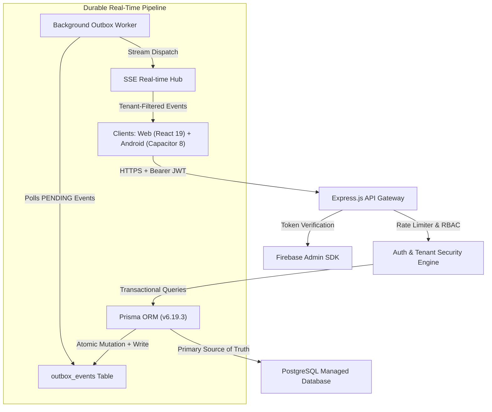

# AARIZO 2.0: SYSTEM ARCHITECTURE & ENGINEERING SPECIFICATION

## 1. High-Level System Architecture

## 2. Core Subsystems

### 2.1 Single Authoritative Source of Truth
* **PostgreSQL:** Sole store for users, societies, flats, towers, payments, invoices, work orders, gate logs, and audit trails.
* **Firebase Auth:** Manages authentication identity, OTP delivery, and tokens.
* **Firebase Storage:** Houses encrypted documents, KYC proofs, and profile photos.
* **Firebase Cloud Messaging:** Handles mobile push delivery for background emergency notifications.

### 2.2 Seven User Roles
1. **Admin:** Platform governance & society provisioning.
2. **Secretary:** Society governance, user onboarding, flat assignment.
3. **Committee:** Financial oversight, compliance review, approvals.
4. **Facility Manager:** Work orders, staff shifts, housekeeping, AMC contracts.
5. **Resident:** QR gate pass creation, maintenance billing, SOS alerts, amenity booking.
6. **Guard:** Gate terminal scanning, visitor verification, child exit checks.
7. **Vendor:** KYC verification, job completion uploads, invoice settlement.

