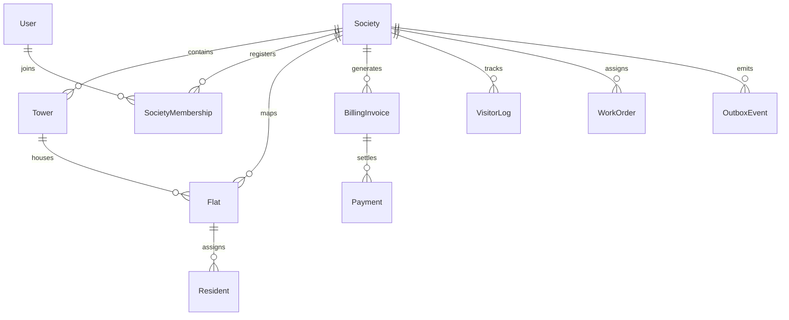

# AARIZO 2.0: DATABASE DESIGN & SCHEMA SPECIFICATION

## 1. Relational Entity Overview
The AARIZO database is implemented with PostgreSQL and Prisma ORM, fully normalized with composite tenant indexes and foreign key cascades.

## 2. Table Groups

### Identity & Tenancy
* `societies`: Society name, code, city, towers count, flats count, status.
* `users`: Primary profile, email, phone, role, status.
* `society_memberships`: Join table linking `userId` to `societyId` with role and status.

### Society Units & Occupancy
* `towers`: Block codes, floor counts, unit allocations.
* `flats`: Flat numbers, BHK configurations, occupancy status.
* `residents`: Resident type (OWNER/TENANT), vehicle associations.

### Financial Management
* `billing_cycles`: Monthly maintenance cycles.
* `billing_invoices`: Detailed breakdown, due date, status (`PENDING`, `PAID`, `OVERDUE`).
* `payments`: Razorpay order ID, payment ID, signature verification flag, settled amount.
* `wallet_transactions`: Ledger-based resident wallet for amenities and clubhouse.
* `refunds`: Refund tracking linked to Razorpay refund IDs.

### Gate & Security
* `visitor_passes`: Cryptographically generated QR tokens, validity windows, visitor types.
* `visitor_logs`: Check-in, check-out, guard IDs, overstay tracking.
* `emergency_incidents`: SOS alert logs, locations, dispatch statuses.

### Operations & Maintenance
* `work_orders`: SLA tracking, priority, staff assignment, actual costs.
* `attendances`: Daily staff and guard check-ins, shift verification.
* `amc_contracts`: Vendor equipment contracts, renewal deadlines.
* `compliance_documents`: Fire safety NOCs, elevator audit records.

### Real-Time Infrastructure
* `outbox_events`: Transactional outbox records (`eventId`, `eventType`, `payload`, `status`).
