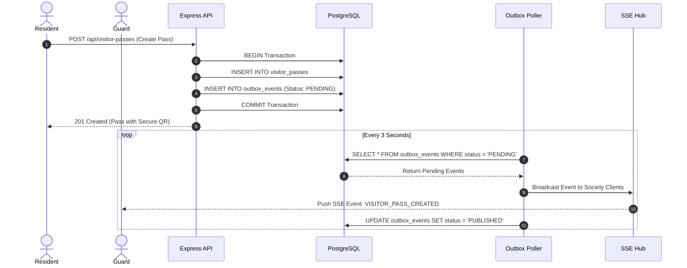

# AARIZO 2.0: REAL-TIME ARCHITECTURE SPECIFICATION

## 1. Overview
The AARIZO 2.0 real-time engine delivers cross-device synchronization between web browsers, guard terminals, and mobile devices without relying on in-memory buffers or client-only BroadcastChannels.

---

## 2. Transactional Outbox Pattern

---

## 3. Resilience & Mobile Continuity
1. **Heartbeat Pings:** Server dispatches `:keepalive\n\n` every 15s to keep connections open through carrier NAT firewalls and battery-saver modes.
2. **Exponential Reconnect:** On network drop, client reconnects using `1000 * Math.pow(1.5, attempts)` backoff up to 15s.
3. **Last-Event-ID Replay:** When reconnecting, the client sends its last received event ID; the server queries `outbox_events` and replays all missed events in chronological order.
4. **Tenant Scoping:** Events are strictly filtered by `societyId` and verified target `role`.

